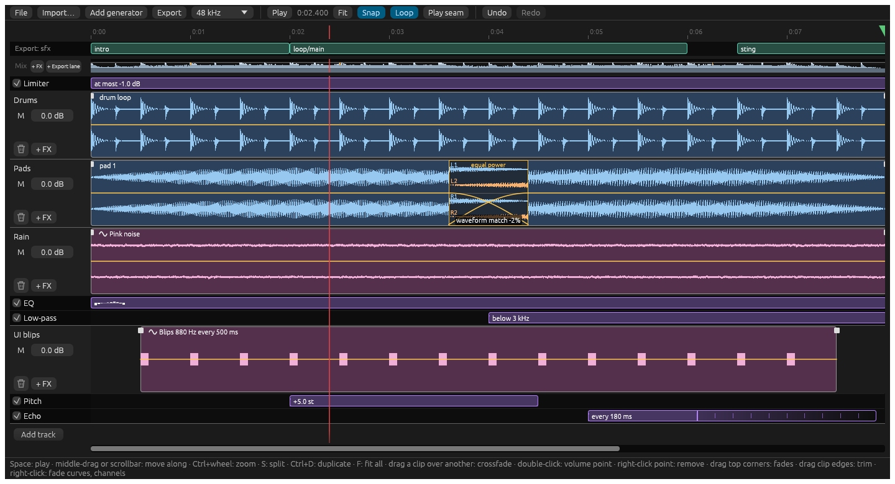

# Refrain

A small multitrack audio editor for game loops and sound effects, written in Rust.



Every edit stays editable. Trims, fades, crossfades, volume curves, speed and effects are settings stored in
the project; the audio files are never changed. Refrain is not a DAW: no MIDI, no plugins, no mixer busses.

## What it does

- **Tracks and clips** with trims, fades, volume curves and crossfades. A crossfade shows how well the two
  waveforms match and can move to the best match.
- **Loops** that play round without a seam: audio past the loop end goes on at the start.
- **Effect lanes** under a track or the mix: normalize, loudness, high-pass, low-pass, 10-band EQ, echo,
  reverb, limiter, pitch and repair (fills a click or a short blip from the sound around it). Each lane holds ranges with their own settings; echo and reverb can run reversed.
- **Clip speed**, like a tape (faster is higher) or keeping the pitch.
- **Generated sound**: tones, noise and blips, stored as settings and made again for any length or loop.
- **Export lanes**: named ranges of the mix, each exported as a file of its own, plus export of the whole mix
  to WAV, FLAC, MP3, AAC (M4A) or Ogg Vorbis.
- **Recovery** of unsaved work after a crash.

Refrain is at an early stage. There are no releases yet.

## Building

You need a recent stable Rust (1.95 or newer).

```sh
cargo run --release -p refrain
```

On Linux the audio output needs the ALSA development files and `pkg-config` (`libasound2-dev` on
Debian and Ubuntu, `alsa-lib` on Arch).

The editor without the window lives in `crates/engine`; `AGENTS.md` describes the layout and the rules
the code follows. Run the tests with `cargo test`.

## Licence

Licensed under either of [Apache License 2.0](LICENSE-APACHE) or [MIT](LICENSE-MIT), at your option.
